# ⚽ Serie A Futbol Ligi Yönetim Sistemi

Modern bir İtalya Serie A futbol ligi takip ve yönetim uygulaması.
Proje; **ASP.NET Core Web API**, **ASP.NET Core MVC WebUI** ve **.NET
MAUI mobil uygulaması** bileşenleriyle maçları, takımları, fikstürü,
puan durumunu ve lig istatistiklerini tek bir yapı altında sunmak
amacıyla geliştirilmiştir.

> Proje, yazılım geliştirme ve portföy çalışması kapsamında
> hazırlanmıştır. Ekran görüntülerindeki sezon ve maç verileri
> uygulamadaki örnek/veri setini temsil edebilir.

## 📌 Proje Hakkında

Serie A projesi; futbol ligi verilerinin yönetilebildiği, API üzerinden
sunulabildiği ve farklı arayüzlerde görüntülenebildiği katmanlı bir
uygulamadır.

-   **Yönetim paneli:** Takım ve maç kayıtlarını yönetme, maçları
    haftalara göre görüntüleme ve maç detaylarına erişme.
-   **Kullanıcı arayüzü:** Fikstür, puan durumu, takım performansları ve
    lig istatistiklerini masaüstü ve mobil görünümlerde sunma.
-   **REST API:** Takım, maç, puan durumu ve istatistik verileri için
    HTTP uç noktaları.
-   **Veri katmanı:** Entity Framework Core üzerinden SQL Server ile
    çalışma.
-   **Mobil uygulama:** .NET MAUI ile mobil kullanım için geliştirilen
    uygulama bileşeni.

## ✨ Öne Çıkan Özellikler

### ⚽ Maç ve fikstür yönetimi

-   Maçları haftalara göre listeleme.
-   Ev sahibi, deplasman, skor, tarih, stadyum ve maç durumunu
    görüntüleme.
-   Maç oluşturma, düzenleme ve silme işlemleri.
-   Maç detayında goller, kartlar ve oyuncu değişiklikleri gibi olayları
    görüntüleme/yönetme.

### 🏆 Takımlar ve puan durumu

-   Takım listesini ve takım logolarını görüntüleme.
-   Takım ekleme, düzenleme, silme ve detay sayfaları.
-   Oynanan maç, galibiyet, beraberlik, mağlubiyet, atılan/yenen gol,
    averaj ve puan bilgileri.
-   Şampiyonluk, Avrupa kupaları ve düşme hattını görsel olarak ayıran
    sıralama arayüzü.
-   Takım adına göre arama ve sıralama filtreleri.

### 📊 Lig istatistikleri

-   Genel lig özeti: takım sayısı, toplam maç, tamamlanan maç, kalan
    maç, toplam gol ve kart sayıları.
-   Gol ortalaması ve haftalara göre gol trendi.
-   En golcü takımlar.
-   Gol krallığı listesi.
-   En çok gol atılan maçlar.

### 🛠️ Yönetim paneli

-   Genel bakış ekranı ve özet kartları.
-   Maç yönetimi ve hafta filtresi.
-   Takım yönetimi ve takım detayları.
-   Fikstür ve puan durumu ekranları.
-   Yönetim işlemleri için sade ve tutarlı arayüz.

### 📱 Mobil ve duyarlı arayüz

-   Mobil ekrana uyumlu fikstür, puan durumu ve istatistik sayfaları.
-   Takım logoları ve maç skorlarıyla kolay okunabilir ekranlar.
-   Masaüstü ve mobil kullanım için ayrı düzenlemeler.

### 🔌 API

Swagger arayüzüyle API uç noktalarını inceleme ve test etme imkânı.

Görüntülerde yer alan uç nokta grupları: - `Matches`: maç listeleme,
oluşturma, güncelleme, silme; hafta ve maç ID'sine göre sorgulama; gol,
kart ve oyuncu değişikliği işlemleri. - `Standings`: puan durumu
verileri. - `Statistics`: genel bakış, gol krallığı, yüksek skorlu
maçlar ve haftalık gol verileri. - `Teams`: takım listeleme, oluşturma,
güncelleme, detay ve silme.

## 🧰 Kullanılan Teknolojiler

  Teknoloji               Kullanım
  ----------------------- -------------------------------
  C#                      Uygulama geliştirme dili
  .NET 8                  Uygulama altyapısı
  ASP.NET Core Web API    REST API katmanı
  ASP.NET Core MVC        Web arayüzü ve yönetim paneli
  Entity Framework Core   ORM ve veritabanı erişimi
  Microsoft SQL Server    İlişkisel veritabanı
  Swagger / OpenAPI       API dokümantasyonu ve test
  .NET MAUI               Mobil uygulama bileşeni
  HTML, CSS, JavaScript   Web arayüzü

## 🖥️ Ekran Görüntüleri

Ekran görüntüleri depodaki `docs/images/` klasöründe tutulur.

### WebUI --- Kullanıcı arayüzü

#### Fikstür ve maç sonuçları

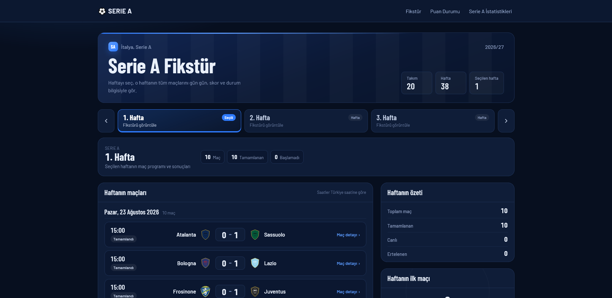

#### Puan durumu

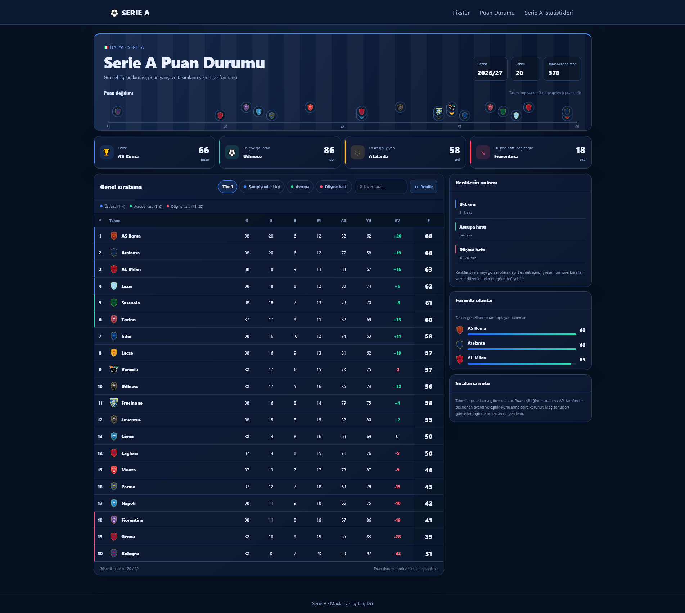

#### Lig istatistikleri

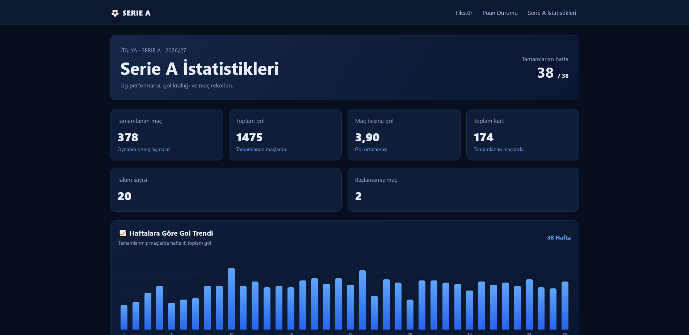

#### Maç detayları

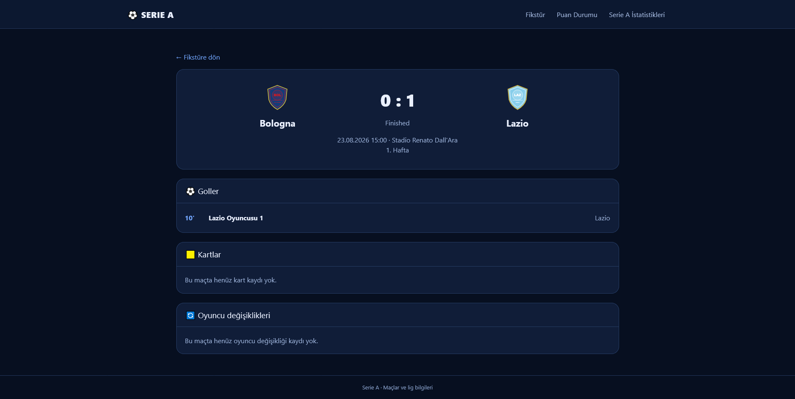

### Yönetim paneli

#### Genel bakış

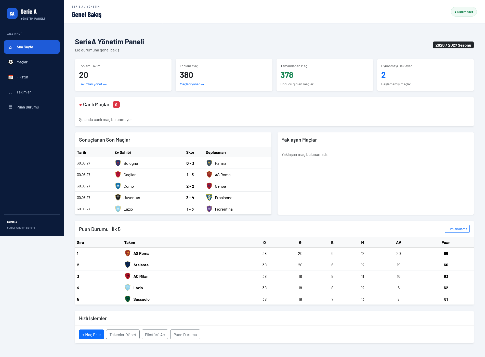

#### Maç yönetimi

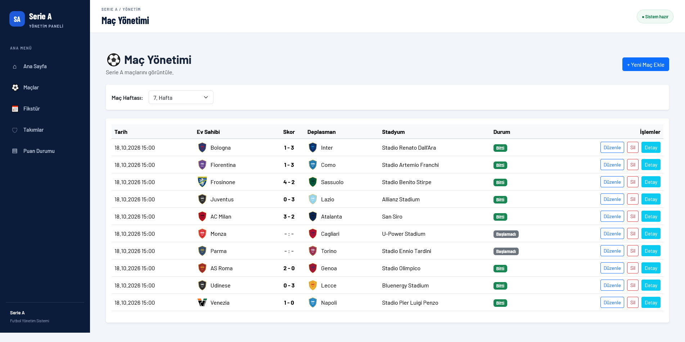

#### Fikstür yönetimi

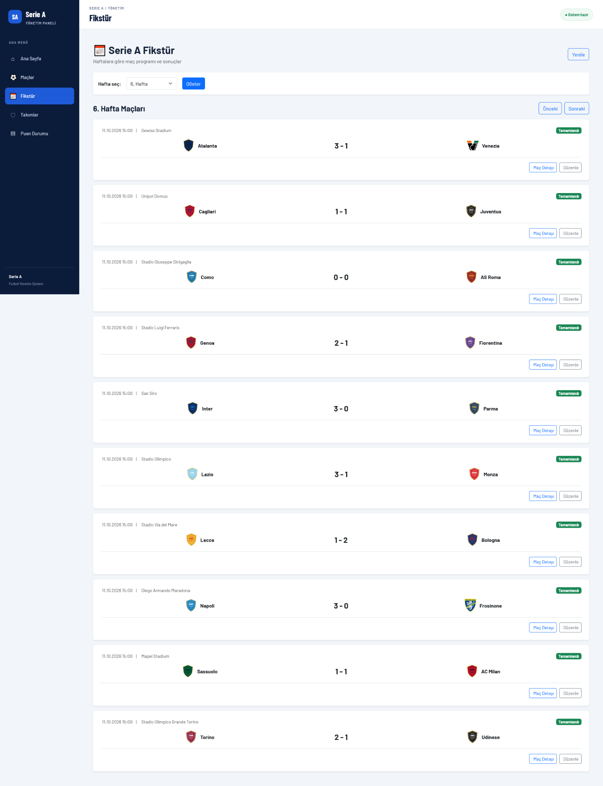

#### Takım yönetimi

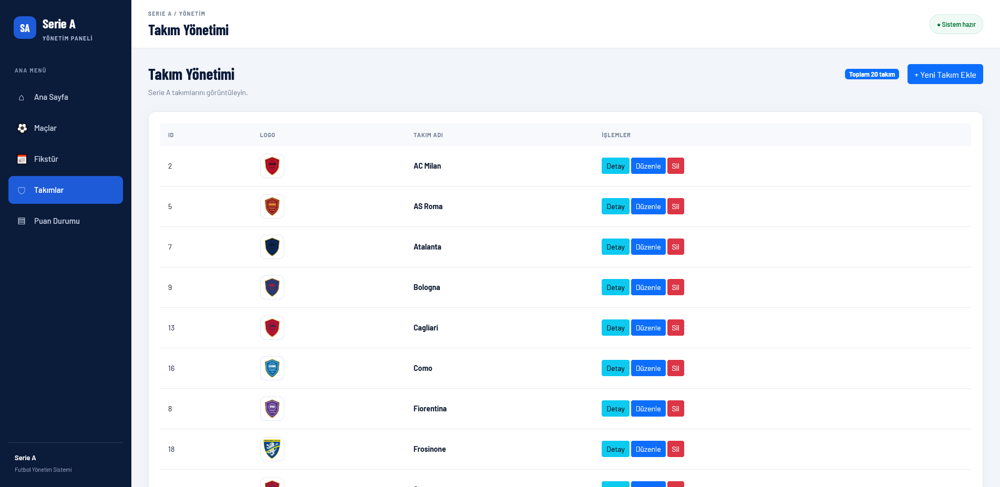

#### Takım detayları

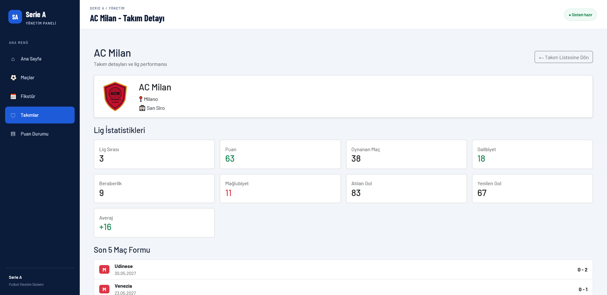

#### Yönetim panelinde puan durumu

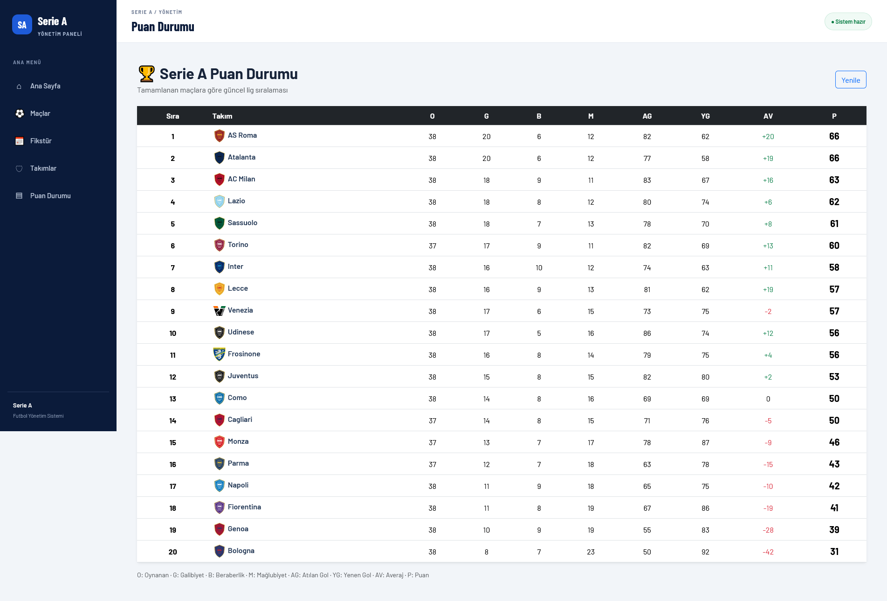

### Mobil arayüz

#### Mobil fikstür

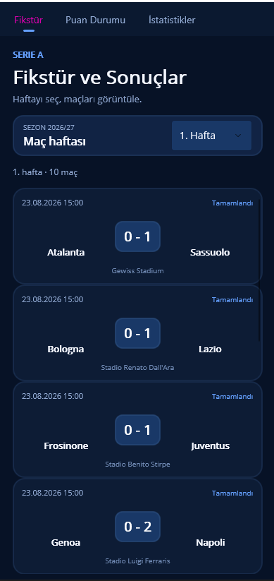

#### Mobil puan durumu

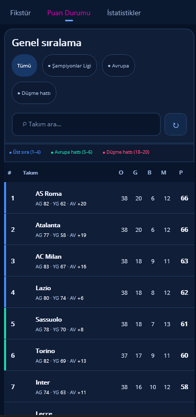

#### Mobil puan durumu filtreleme


#### Mobil istatistikler

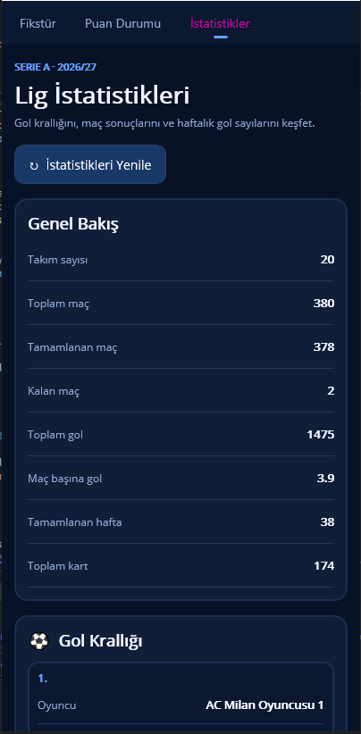

### API --- Swagger

#### API uç noktaları

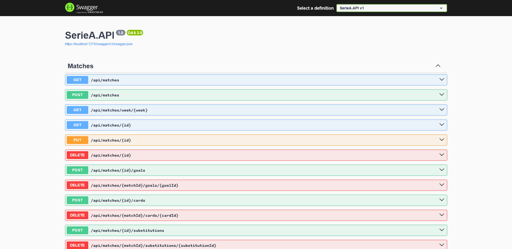

#### API uç noktaları ve veri modelleri

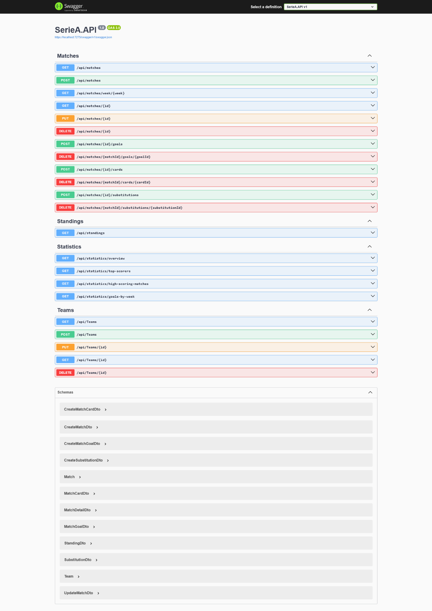

## 🏗️ Proje Mimarisi

``` text
Kullanıcı
   ├── Web tarayıcısı
   │      └── SerieA.WebUI (ASP.NET Core MVC)
   │                    └── SerieA.API (ASP.NET Core Web API)
   │                                  └── Entity Framework Core
   │                                                └── SQL Server
   └── Mobil istemci (.NET MAUI)
          └── API üzerinden veri erişimi (uygulamadaki entegrasyon kapsamına göre)
```

### Temel API uç noktaları

``` http
GET    /api/matches
POST   /api/matches
GET    /api/matches/week/{week}
GET    /api/matches/{id}
PUT    /api/matches/{id}
DELETE /api/matches/{id}

POST   /api/matches/{id}/goals
DELETE /api/matches/{matchId}/goals/{goalId}
POST   /api/matches/{id}/cards
DELETE /api/matches/{matchId}/cards/{cardId}
POST   /api/matches/{id}/substitutions
DELETE /api/matches/{matchId}/substitutions/{substitutionId}

GET    /api/standings
GET    /api/statistics/overview
GET    /api/statistics/top-scorers
GET    /api/statistics/high-scoring-matches
GET    /api/statistics/goals-by-week

GET    /api/teams
POST   /api/teams
GET    /api/teams/{id}
PUT    /api/teams/{id}
DELETE /api/teams/{id}
```

> API adresleri ve uç nokta isimlerini son yüklemeden önce
> controller/route tanımlarınla karşılaştır.

## 🚀 Kurulum

### Gereksinimler

-   .NET 8 SDK
-   Microsoft SQL Server
-   Visual Studio 2022
-   Git

### 1. Depoyu klonlayın

``` bash
git clone https://github.com/muslumgumusluoglu/SerieA-Football.git
cd SerieA-Football
```

### 2. Veritabanı bağlantısını ayarlayın

`SerieA.API` projesindeki `appsettings.json` veya geliştirme ortamındaki
gizli yapılandırma dosyasında kendi SQL Server bağlantı dizenizi
tanımlayın. Örnek:

``` json
{
  "ConnectionStrings": {
    "DefaultConnection": "Server=.;Database=SerieADb;Trusted_Connection=True;TrustServerCertificate=True;"
  }
}
```

Bağlantı anahtarının adını, projedeki `AppDbContext` yapılandırmasıyla
aynı olacak şekilde kullanın. Gerçek kullanıcı adı/parola veya üretim
bağlantı bilgilerini GitHub'a yüklemeyin.

### 3. Veritabanını oluşturun

Solution klasöründe, `DbContext` ve migration'ların bulunduğu projeyi
seçerek:

``` bash
dotnet ef database update
```

EF araçları kurulu değilse:

``` bash
dotnet tool install --global dotnet-ef
```

Başlangıç projesi ve migration projesi farklıysa komuta
`--startup-project` ve `--project` parametrelerini ekleyin.

### 4. Uygulamayı çalıştırın

Visual Studio 2022'de `SerieA.sln` çözümünü açın. API ve WebUI
projelerini başlangıç projeleri olarak yapılandırıp çalıştırın. Mobil
uygulama için `SerieA.Mobile` projesini ve uygun bir hedef
cihazı/emülatörü seçin. Komut satırından çalıştırmak için ilgili proje
klasöründe:

``` bash
dotnet run
```

Swagger adresini API projesinin `launchSettings.json` dosyasında tanımlı
URL üzerinden açın.

> Gerçek klasör isimleri ve çalıştırma profilleri solution yapına göre
> değişebilir.

## 🧪 API'yi Test Etme

1.  API projesini çalıştırın.
2.  Swagger arayüzünü açın.
3.  `Matches`, `Standings`, `Statistics` ve `Teams` gruplarını
    inceleyin.
4.  GET istekleriyle verileri kontrol edin; POST/PUT/DELETE işlemlerini
    geliştirme veritabanında deneyin.

## 🔐 Güvenlik Notları

-   Veritabanı parolalarını ve gizli anahtarları kaynak koda eklemeyin.
-   `appsettings.Development.json` gibi gizli bilgiler içerebilen
    dosyaları Git'e eklemeden önce `.gitignore` ve dosya içeriğini
    kontrol edin.
-   Gerçek kişisel veya hassas veriler kullanmayın.

## 🗺️ Geliştirme Fikirleri

-   Kullanıcı girişi ve rol bazlı yetkilendirme.
-   Canlı skor ve dış futbol veri servisleri entegrasyonu.
-   Gelişmiş filtreleme ve takım karşılaştırma ekranları.
-   Birim ve entegrasyon testleri.
-   CI/CD iş akışı ve otomatik dağıtım.
-   Mobil uygulama deneyiminin geliştirilmesi.

## 👨‍💻 Geliştirici

Bu proje, .NET ekosisteminde API, web arayüzü, veritabanı ve mobil
uygulama geliştirme becerilerini bir araya getirmek amacıyla
hazırlanmıştır.

GitHub profili:
[muslumgumusluoglu](https://github.com/muslumgumusluoglu)

## 📄 Lisans

Depoda bir `LICENSE` dosyası bulunmuyorsa proje için henüz açık kaynak
lisansı belirtilmemiştir. Projeyi açık kaynak olarak paylaşmak
istiyorsanız amacınıza uygun bir lisans seçip depoya `LICENSE` dosyası
ekleyebilirsiniz.
